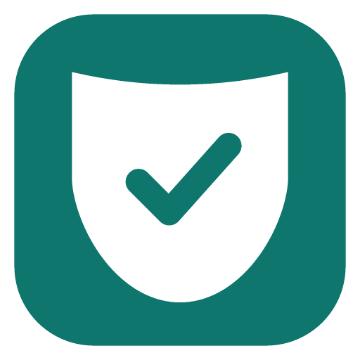

<div align="center">



# Ardvane

**Free, open-source protection for developers against malware that spreads through code:
fake job interviews, malicious packages and the PolinRider worm.**

Find it · block it · fix it · and stay on top of it every day. Everything runs on your own computer.

[](https://github.com/Abdul-Moiz31/ardvane/actions/workflows/tests.yml)
[](https://github.com/Abdul-Moiz31/ardvane/releases)
[](LICENSE)
-blue)


[Get started](#get-started) ·
[What it does](#what-it-does) ·
[How it protects you](#how-it-protects-you) ·
[Accuracy](#accuracy) ·
[I think I'm infected](docs/after-a-scan/if-danger-found.md) ·
[Contributing](CONTRIBUTING.md)

</div>

---

## Why Ardvane exists

Developers are being targeted by state-sponsored malware (North Korea's *Contagious Interview* campaign) that spreads
**through code**: fake recruiters with "take-home tests", fake npm packages and malicious editor extensions. Once inside,
a worm uses your stolen GitHub access to **force-push itself into every repository you can reach**, including your
teammates' and your company's.

I was hit **three times in five weeks**. A clean reinstall lasted three days. Deleting files, rewriting history and
revoking tokens didn't stop it, because it kept coming back through infected repositories and collaborators. Ardvane is
everything that finally worked, packaged so you don't lose the weeks I did. → [Read the story](docs/story)

> 🛑 **Think you're infected right now?** Go to [`docs/after-a-scan/if-danger-found.md`](docs/after-a-scan/if-danger-found.md). The order of the steps matters.

<a id="get-started"></a>

## 🚀 Get started

**1. Install** with one command:

| | |
|---|---|
| **macOS** (Homebrew) | `brew install abdul-moiz31/ardvane/ardvane` |
| **macOS, Linux, Windows** (Python 3.8+) | `pipx install ardvane` |

No pipx yet? `brew install pipx` on a Mac, `py -m pip install --user pipx` on Windows, or use
`python3 -m pip install --user ardvane` instead.

**2. Open Ardvane:**

```bash
ardvane
```

The dashboard opens in your browser and runs **only on your computer**. Press **Scan now**, then:

- **Protection → Turn on protection**: you see every change before it's made
- **Overview → Daily check**: choose your time (9:00 by default)
- **Protection → Add app icon**: adds Ardvane to your Applications folder (Start menu on Windows), so from now on you
  open it from Launchpad, Spotlight or the Dock, with no terminal

→ [Dashboard guide](docs/dashboard.md)

**Prefer the terminal?**

| Command | What it does |
|---|---|
| `ardvane scan` | Read-only scan of this computer and your projects (`--quick` for machine checks only) |
| `ardvane check <folder>` | Scan one folder before you open it: a download, a coding test, a colleague's repo |
| `ardvane check-github <owner/repo>` | Scan every branch of GitHub repositories without cloning them |
| `ardvane update-detections` | Download the latest signed detection list now (scans and the daily check do this anyway) |
| `ardvane protect` | Turn on protection (`--dry-run` shows every change first) |
| `ardvane unprotect` | Remove protection and restore your previous settings |
| `ardvane fixes` | What Ardvane can fix for you, with undo |
| `ardvane --help` | Everything else |

The scan ends with ✅ **CLEAN**, ⚠️ **worth a look** or 🛑 **INFECTED**, says exactly what to do next, and saves a report.
Update with `brew upgrade ardvane` or `pipx upgrade ardvane`.

<details>
<summary>Run from source instead (contributors, or no Homebrew / pipx)</summary>

```bash
git clone https://github.com/Abdul-Moiz31/ardvane.git
cd ardvane
python3 app/dashboard.py            # = `ardvane`; add a command, e.g. python3 app/dashboard.py scan
```

The scripts also work on their own: `bash scan-my-machine.sh`, `bash mac/install.sh`, `bash mac/install-routine.sh 9:00`,
and on Windows (beta) the matching `.ps1` files in `windows/`.

</details>

<a id="what-it-does"></a>

## ✨ What Ardvane does

| | |
|---|---|
| 🔍 **Scans your computer** | Malware locations, running malware, startup items, attacker connections, editor settings, every git project and every installed package |
| 🧱 **Blocks infected code** | `git clone` checks a repository *before* its files are written; `git pull` / `checkout` warn you; `git push` is blocked if a repository contains malware |
| ⚙️ **Hardens your tools** | VS Code / Cursor can't auto-run code when you open a folder; npm packages can't run install scripts |
| 🔧 **Fixes, with undo** | Fixes what's safe to fix (editor and npm settings, switched-off protection, malware in known locations), **ask first** by default or **automatic** if you choose. Malware is quarantined, never deleted |
| ✅ **To-do list** | Every finding becomes a short checklist; a real infection opens the recovery checklist; a later scan checks that your fix worked |
| 🤖 **GitHub Action** | The same scanner on every push and pull request, and every branch every night, for teammates and branches nobody opens locally: `uses: Abdul-Moiz31/ardvane@v0.3.0` ([how](docs/github-action.md)) |
| 📦 **Safe install** | `npm`, `npx`, `pnpm`, `yarn`, `bun` and `pip` check every package an install would add against known malware (Ardvane's list plus OSV.dev's malicious-package database) and stop if one is |
| ☀️ **Daily check** | Runs at the time you choose, notices if malware switched your protection off, and shows a notification |
| 🐙 **GitHub check** *(optional)* | Warns about many repos pushed at once and scans recently pushed repos, plus every branch of any repos you list (yours, your organization's, a teammate's). Your token stays in the GitHub CLI |
| 📚 **Guides** | Every attack explained, and step-by-step recovery: cut off access, clean repositories, rotate secrets, harden |

<a id="how-it-protects-you"></a>

## 🛡️ How it protects you

| You do | Ardvane does |
|---|---|
| `git clone …` in a terminal | Downloads without writing project files → scans → **blocks** the clone if infected |
| `git pull`, `git checkout` | Scans and warns you before you open anything |
| `git push` | **Blocks** the push if the repository contains malware |
| Open a folder in VS Code / Cursor | Nothing runs on its own (automatic tasks off, Workspace Trust on) |
| `npm install` | Packages can't run install scripts |
| Every day at your time | Checks your machine, projects, protections and (optionally) GitHub, then adds anything it finds to your to-do list |
| `checkrepo <folder>` | Scan anything before you open it: a download, a coding test, a colleague's repo |

A scan takes about **0.1–0.7 seconds per repository**. When everything is clean you won't notice it.

## 🔒 Safe by design

- **Local only.** No account, no telemetry, no cloud. The dashboard listens on `127.0.0.1`, needs a per-session key,
  and refuses requests from other websites.
- **Detections that keep up, signed.** Before each scan and daily check, Ardvane downloads a list of new detections
  from GitHub. It is used only if it carries Ardvane's signature and is newer than the copy you have, and it can only
  add detections, never remove one. Nothing about your computer is sent. See [feed/README.md](feed/README.md).
- **Reads, doesn't run.** The scanner only reads files and runs git with hooks and `core.fsmonitor` disabled, so even a
  booby-trapped repository can't make it execute anything.
- **Nothing deleted, everything reversible.** You see every change before it's made, fixes can be undone, and malware is
  quarantined as evidence.
- **No dependencies.** Python's standard library and plain JavaScript. No npm, no build step, no CDN: what you read
  here is exactly what runs.
- **No real malware in this repository.** Tests build synthetic samples at runtime.

<a id="accuracy"></a>

## 📊 Accuracy

The scanner was built from **real malware files** taken from an actual infection, then tuned against clean code:

| Test | Result |
|---|---|
| Real malware files (both payload variants, fake fonts, auto-run tasks, droppers) | **71 / 71 detected** |
| Same files with every known marker switched off (behaviour rules only) | **71 / 71 detected** |
| 18 popular open-source projects, 106,225 files (Font-Awesome, Babel, Webpack, Prettier, javascript-obfuscator…) | **0 false alarms** |
| A developer's 14 real projects + all installed packages, ~240,000 files | **0 false alarms** · 1 real infection leftover found |
| Automated tests: scanner, fixer (incl. attempts to trick it), dashboard security, GitHub check | **97 tests**, run on macOS, Linux and Windows on every change, plus a build-and-install test of the package |

**Honest limits:** Ardvane targets this family of attacks, so a completely new technique may not be detected. That's
why it also hardens your editor, npm, git and GitHub and checks every day. The Windows scripts are beta. A scan can't
prove a machine is clean after a backdoor has run; see the [recovery guide](docs/after-a-scan/if-danger-found.md).

## 📁 What's in the repository

```
ardvane/
├── app/                        the Ardvane dashboard and `ardvane` command (Python standard library + plain JavaScript)
├── packaging/                  builds the PyPI package (standard library only)
├── scan-my-machine.sh / .ps1   one-command, read-only machine scan
├── scanner/                    detection and fixes: checkrepo, autofix, GitHub check, package lists, git hooks, safe clone, tests
├── mac/                        install / uninstall / daily check for macOS and Linux
├── windows/                    the same for Windows (beta)
└── docs/                       guides: the attacks, recovery, hardening, the story
```

## 📚 Learn more

- [The attacks](docs/attacks): PolinRider worm, fake job interviews, BeaverTail / InvisibleFerret stealers, the
  MicrosoftSystem64 backdoor, VS Code auto-run tasks, GlassWorm extensions, malicious npm packages, AI coding-agent
  attacks, ClickFix, EtherHiding
- [If you're infected](docs/after-a-scan/if-danger-found.md) · [Cleaning GitHub repositories](docs/after-a-scan/clean-github-repos.md) ·
  [Secrets rotation](docs/after-a-scan/secrets-rotation-checklist.md) · [Hardening checklist](docs/after-a-scan/hardening-checklist.md)
- Reference: [Dashboard](docs/dashboard.md) · [checkrepo](docs/checkrepo.md) · [Daily check](docs/daily-routine.md) · [Infected packages](docs/infected-packages.md)

## 🤝 Contributing

Contributions are very welcome, especially **Windows test reports**, **new malicious packages or indicators** (with a
link to the public report) and **false-alarm reports**. Read [CONTRIBUTING.md](CONTRIBUTING.md), fork, branch, and open a
pull request; every change needs a test.

Found a security problem in Ardvane itself? Please report it privately; see [SECURITY.md](SECURITY.md).

## 🙏 Credits

Ardvane stands on the work of researchers and other victims who published their findings:
[OpenSourceMalware](https://github.com/OpenSourceMalware/PolinRider) ·
[polinrider-cleaner](https://github.com/meSingh/polinrider-cleaner) (MIT, indicator lists) ·
[Bedri-B/polinrider](https://github.com/Bedri-B/polinrider) (MIT) ·
[pushwarden](https://github.com/FaheemRafiq/pushwarden) · [gitshield](https://github.com/mirzasaikatahmmed/gitshield) ·
Palo Alto Networks Unit 42 · Google Threat Intelligence Group · JFrog Security Research · Socket · Elastic Security Labs ·
Checkmarx · Cloud Security Alliance. Full source lists are at the end of every page in [`docs/attacks`](docs/attacks).

## ⚖️ License and disclaimer

[MIT](LICENSE): use it, share it, adapt it.
Ardvane reduces risk; it cannot guarantee that a machine is clean or will stay clean. It is provided as-is, without warranty.
